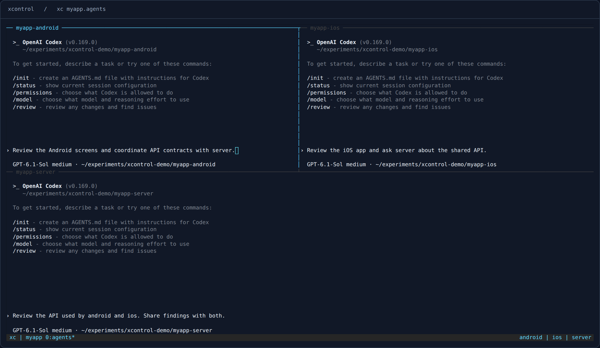

<p></p>

# xcontrol

Run your coding agents in tmux. Resume their sessions and let them message each other.

I used to manage agents across projects with a few tmux scripts. They worked well, so I cleaned them up and shared them here.



## Install

You'll need Linux or WSL2, Python 3.11+, tmux, and your agent CLIs installed and signed in.

```sh
git clone https://github.com/faustinoaq/xcontrol.git
cd xcontrol
./install.sh
```

Keep `~/.local/bin` on your PATH. The installer links to this checkout, so keep it around.

## Local files

xcontrol keeps setup configs, handoff snapshots, message hashes, pending messages from MANUAL mode, watcher logs, and lock files in `$XDG_STATE_HOME/xcontrol` (default: `~/.local/state/xcontrol`). Handoff snapshots can contain private terminal output. Access checks use temporary `xc-probe-*` folders, removed on normal completion. Agent CLIs keep their own history and caches separately. See [file details](docs/reference.md#local-files).

## Uninstall

List and stop your xcontrol groups from another terminal first:

```sh
xc ps
xc stop --all
```

This leaves unrelated tmux sessions running. To stop just one group, use `xc stop /path/to/myapp.agents`, or `xc stop /path/to/project` for a setup group.

Remove the links created by `install.sh`:

```sh
unlink "$HOME/.local/bin/xc"
unlink "$HOME/.local/bin/xcontrol"
unlink "${CODEX_HOME:-$HOME/.codex}/skills/xcontrol"
```

Optionally delete xcontrol's saved state, including handoff snapshots:

```sh
rm -rf -- "${XDG_STATE_HOME:-$HOME/.local/state}/xcontrol"
```

Use the same environment settings you used when installing and running xcontrol. You can then remove the cloned checkout and any shell aliases you added. Your project `.agents` files and the agent CLIs' conversations remain.

## Get started

Already have a config? Open it:

```sh
xc myapp.agents
```

Need help creating one? Run this in your project:

```sh
xc .
```

A setup agent inspects the current folder and its immediate children, then suggests a team. In an empty folder, tell it what you want to build. The prompt limits discovery to your project; it does not sandbox filesystem access. It asks before writing your config. This checks model access with small calls that count toward your usage.

Plain `xc` just shows help.

**Before typing, we recommend turning on MANUAL mode.** Your keyboard and peer messages share the agent's input field, so an incoming message can mix with your draft when MANUAL is off. Typing is always allowed; xcontrol does not detect it or pause deliveries automatically.

Press your tmux prefix (default `Ctrl+b`), then `Alt+m`, and wait for **MANUAL** in the pane border before typing. Peer messages wait in a local queue. After submitting or clearing your draft, toggle it off when the agent has an empty, ready prompt; pending messages arrive together in one submission. Other panes keep working.

For a group already running when you update xcontrol, run `xc manual myapp.agents --bind` once to install the shortcut without restarting agents. You can also use `xc manual myapp.agents server on` and `off`. This is an explicit pause, not automatic typing detection.

## A small example

Save `myapp.agents` beside your project folders:

```toml
name = "myapp"

[[agents]]
id = "android"
folder = "./myapp-android"
agent = "codex"
role = "Android app"

[[agents]]
id = "ios"
folder = "./myapp-ios"
agent = "copilot"
role = "iOS app"

[[agents]]
id = "server"
folder = "./myapp-server"
agent = "claude"
role = "Server APIs"
```

Folders are relative to this file. Roles are labels, not prompts. Use separate folders or worktrees when running the same CLI more than once.

Codex, Copilot, and Claude resume conversations by default. Add `resume = "new"` to start fresh. Other CLIs, such as Devin, work too: set `agent` to their executable name and add any flags in `args`.

**Codex runs with approvals and sandboxing disabled by default.** Set `bypass = false` to keep native permissions. For other supported CLIs, add `bypass = true` to skip tool approvals. On `agent = "auto"`, that setting follows the role when providers switch. It grants broad access under your user account; existing panes need a relaunch to pick it up. Custom CLIs use their own `args`.

## Everyday commands

```sh
xc myapp.agents                  # start or reattach
xc logo                         # show the mascot
xc list                         # installed supported CLIs
xc list --check                 # test model access
xc ps                           # list all xcontrol groups
xc status myapp.agents           # see who's running
xc send myapp.agents server "Please review the API changes"
xc stop myapp.agents             # close the group
xc check myapp.agents            # validate the config, no model calls
```

Use `xc --help` for the command list and `xc list --help` (or any command) for its options.

Detach with `Ctrl+b d`. Agents keep running. Mouse support is on, so you can click panes, resize them, and scroll.

Exiting an agent follows your tmux `remain-on-exit` setting. You can reopen its saved conversation later. To apply config changes, stop and reopen the group.

## Let agents talk

Inside a managed pane, agents can find peers and send messages:

```sh
xc status "$XCONTROL_CONFIG"
xc send "$XCONTROL_CONFIG" ios "Does this API change work for you?"
```

Messages go straight into the other agent's terminal. There is no queue, so a busy agent or an open dialog may need your attention.

Keep messages short: ask a concrete question or send a blocker, decision, or result. Batch questions and share file paths instead of long transcripts. Skip acknowledgments and repeated status requests. Identical messages from the same sender to the same pane are skipped for five minutes; use `--force` only when you need to resend.

## Pick an available agent

Replace an agent's CLI choice with:

```toml
agent = "auto"
candidates = ["codex", "copilot", "agy", "devin", "kiro-cli", "agent", "grok", "claude"]
```

Supported CLIs: Codex, Claude, Copilot, Antigravity (`agy`), Devin, Kiro (`kiro-cli`), Cursor (`agent`), and Grok. Other CLIs can use custom commands. Install and sign in separately; xcontrol does not choose a pricing plan.

xcontrol tries candidates in order with a small model call and picks the first that answers. These calls count toward usage and may cost money. Reattaching doesn't check again. To change a running pane, use `xc switch`.

## Hit a usage limit?

Switch just that pane from another terminal:

```sh
xc switch myapp.agents server copilot
xc switch myapp.agents server agy
xc switch myapp.agents server devin
xc switch myapp.agents server             # next available CLI for one pane
xc switch myapp.agents --auto             # next available CLI for every pane
```

The new CLI gets the role, recent terminal history, and Git state. Other panes keep running. Add `--note "what to continue"` if useful.

Switch when the old agent is idle or blocked: it is replaced. This starts a fresh conversation, not a full history import. Selection without a CLI makes small access-check calls. For optional automatic handoffs:

```sh
xc watch myapp.agents --detach   # enable quota watching in the background
xc watch myapp.agents --stop     # disable it; agents keep running
```

To start watching automatically with each new group, add this at the top of your `.agents` file:

```toml
watch = true
```

Off by default. `agent = "auto"` alone only chooses the starting provider. The watcher runs as a local background Python process, not another AI agent. Reattaching does not start a second watcher or undo `xc watch PROJECT --stop`; closing and reopening starts it again when `watch = true`.

With `watch = true`, supported agents also receive startup instructions to preserve brief task checkpoints at natural milestones. A replacement gets its role, recent terminal history and Git state; it verifies project notes and unfinished work before continuing. Full native conversation history is not transferred.

The watcher uses no model while waiting. A quota notice must stay unchanged for a minute, then a small model call must also confirm the limit. It passes context to the next available CLI and avoids looping through exhausted providers. Detection depends on each CLI's error messages, so manual switching remains available. It stops with the project group. Without `watch = true`, start it explicitly again after reopening.

## Compact a conversation

```sh
xc compact myapp.agents server
```

Request the CLI's own context compaction from another pane, with the target at an empty idle prompt. Cursor receives `/compress`; the others receive `/compact`. Compaction may use model allowance and does not reset usage limits.

To let agents decide when to request it, add this at the top of your `.agents` file, before any tables:

```toml
auto_compact = true
```

Off by default. At startup, agents receive instructions to use context pressure as the signal and ask one peer to compact them at a safe pause. No periodic questions or timers. This is an agent policy, not a guaranteed background scheduler; existing conversations need the instruction or a new launch.

## Ask your agent to set it up

The included [skill](skills/xcontrol/SKILL.md) is plain `SKILL.md`, not Codex-specific. The installer links it into Codex's skill directory by default; for another compatible CLI, copy or link `skills/xcontrol` into that tool's documented skill directory. Try:

> Use xcontrol to create myapp.agents with myapp-android using Codex, myapp-ios using Copilot, and myapp-server using Claude.

See the [reference](docs/reference.md) for resume options, custom CLIs, access checks, and troubleshooting.

## Related tools

There are plenty of options, including T3 Code and Herdr. If you already use tmux, xcontrol is a small wrapper around the setup you have.

| Tool | What it provides |
| --- | --- |
| [T3 Code](https://github.com/pingdotgg/t3code) | A graphical interface for working with coding agents |
| [Herdr](https://github.com/herdrdev/herdr) | An agent-aware terminal runtime and workspace manager |
| [tmux](https://github.com/tmux/tmux) | Persistent terminal sessions and panes; xcontrol uses it underneath |
| [Zellij](https://github.com/zellij-org/zellij) | A terminal workspace and multiplexer |
| [WezTerm](https://github.com/wezterm/wezterm) | A terminal emulator with multiplexing |
| [cmux](https://github.com/manaflow-ai/cmux) | A macOS terminal with workspaces and agent notifications |
| [Vibe Kanban](https://github.com/BloopAI/vibe-kanban) | A board-based interface for organizing coding agent work |
| [Claude Squad](https://github.com/smtg-ai/claude-squad) | A terminal manager for multiple coding agents |
| [Agent of Empires](https://github.com/agent-of-empires/agent-of-empires) | A tmux-based agent manager with terminal and web interfaces |
| [workmux](https://github.com/raine/workmux) | Git worktrees and tmux windows for parallel agent tasks |
| [dmux](https://github.com/standardagents/dmux) | A multiplexer for coding agents and Git worktrees |
| [Agent Deck](https://github.com/asheshgoplani/agent-deck) | A terminal session manager for coding agents |

Additional UI options include [Conductor](https://www.conductor.build/) and [Rex](https://www.superlogical.com/rex/).

## Development

```sh
python3 -m unittest discover -s tests -v
```

Tests use isolated tmux servers and fake agents. No model calls.

MIT licensed.
